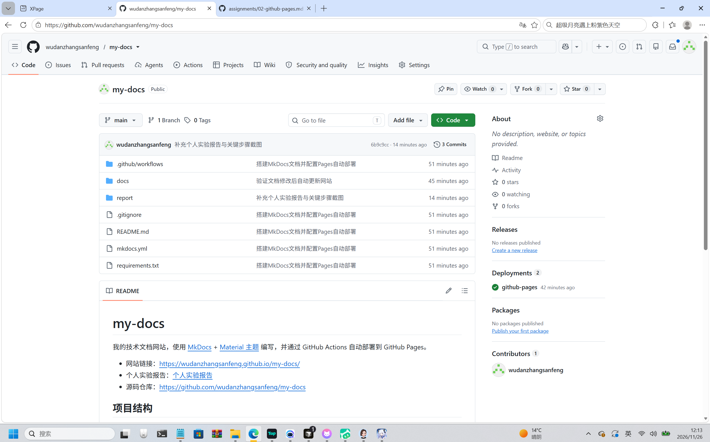
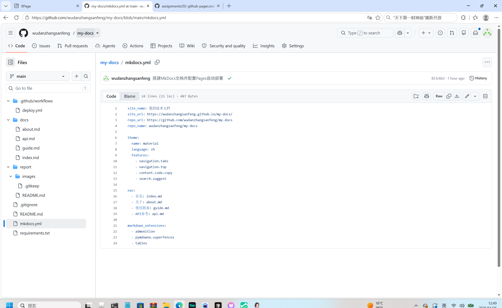
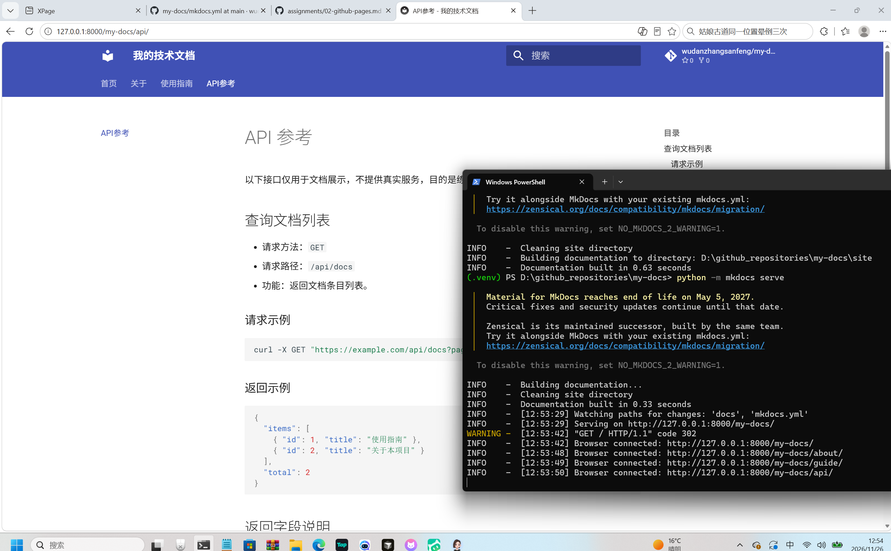
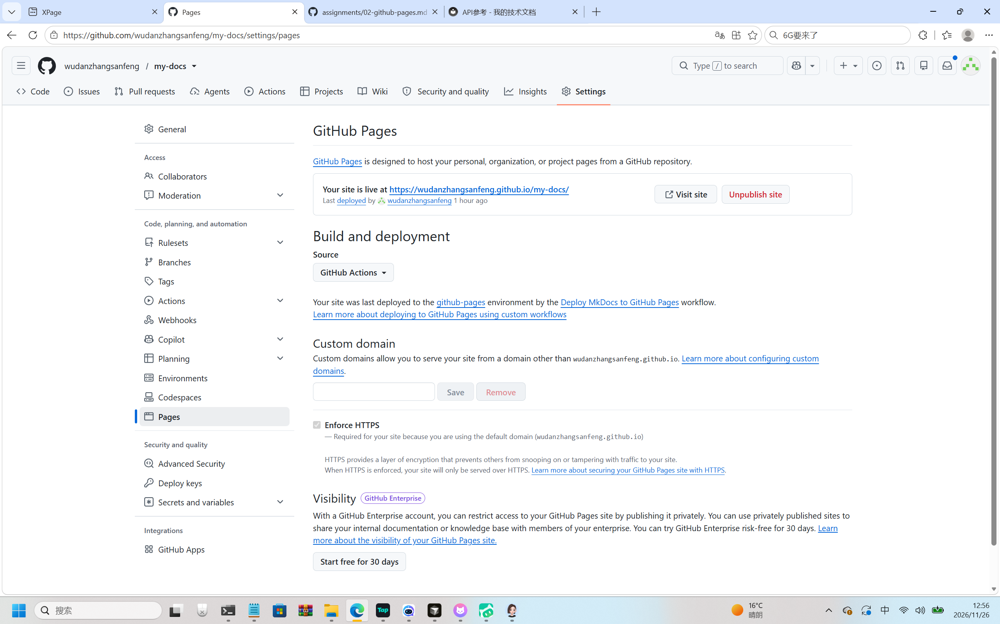
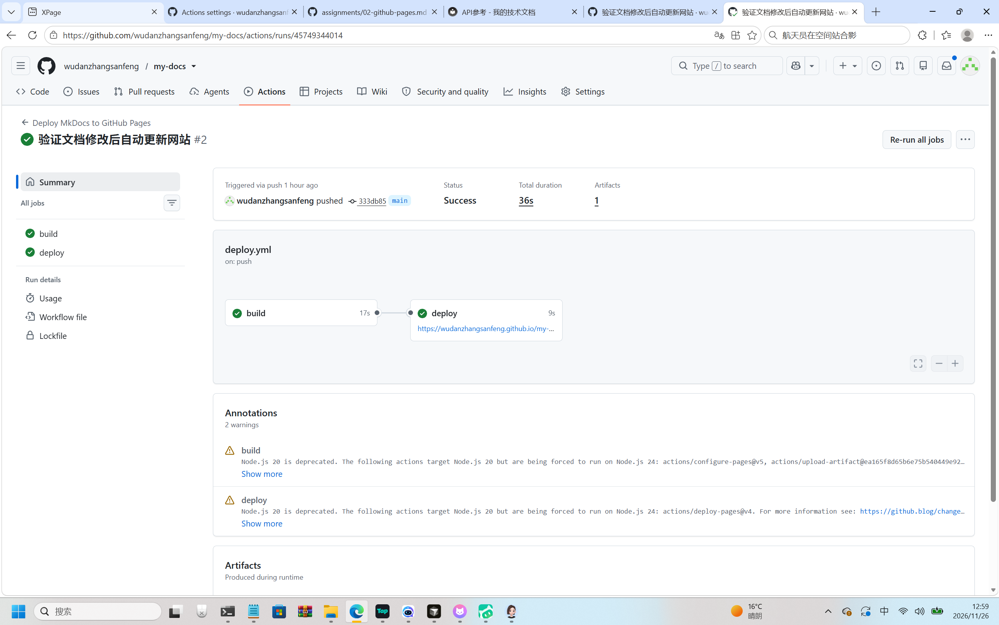
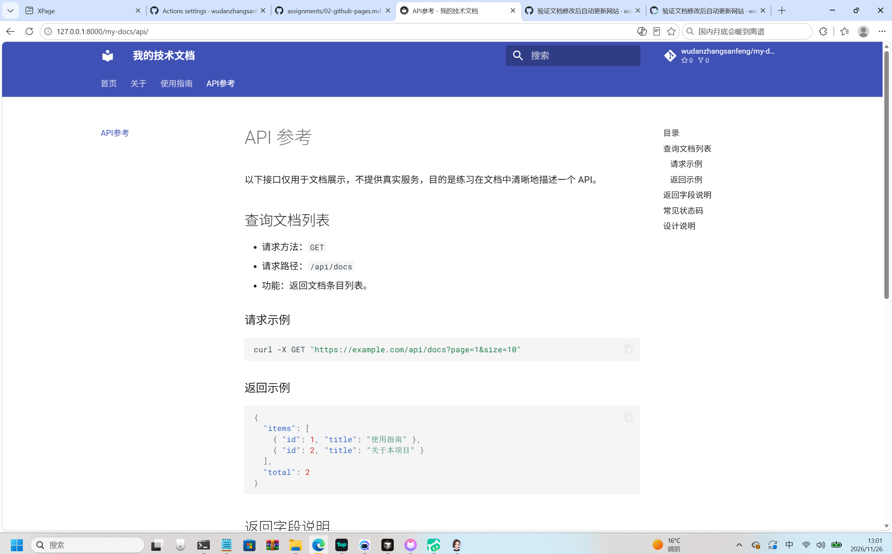
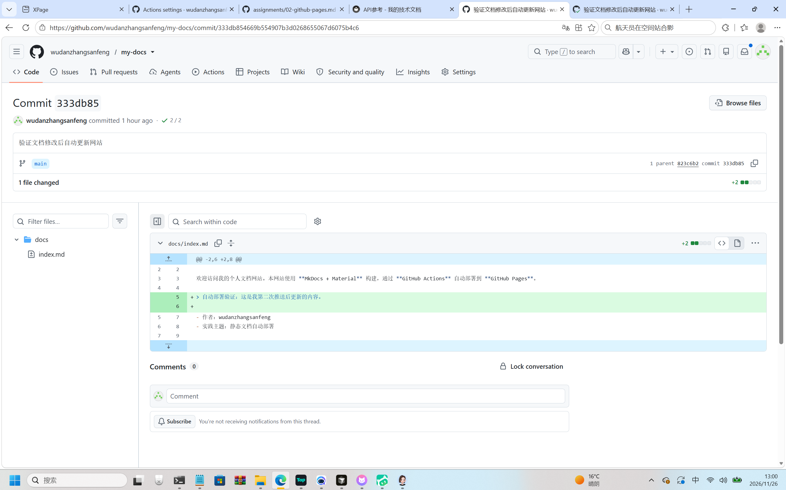

# 实践项目2：个人实验报告

> 说明：本报告中的截图位于 `report/images/` 目录，采用相对路径引用。请按各小节说明，在完成对应步骤时截屏并按文件名保存，截图均需体现本人账号与真实运行记录。

## 1. 基本信息

- GitHub 登录名：wudanzhangsanfeng
- 个人仓库地址：https://github.com/wudanzhangsanfeng/my-docs
- 最终网站地址：https://wudanzhangsanfeng.github.io/my-docs/

## 2. 实践过程与关键截图

### 2.1 仓库创建

登录 GitHub 后新建一个 **Public** 仓库，命名为 `my-docs`，默认分支为 `main`，并克隆到本地。仓库首页需能看清所有者、仓库名与 `Public` 标识。

### 2.2 项目结构与 MkDocs 配置

在仓库根目录建立如下结构：`docs/` 存放四个 Markdown 页面；`mkdocs.yml` 配置站点名称、`site_url`、主题与 `nav` 导航；`site/` 是构建产物，已被 `.gitignore` 忽略，不提交。`nav` 中的路径相对于 `docs/`，例如写 `index.md` 而不是 `docs/index.md`。

### 2.3 本地构建或预览

创建虚拟环境并安装依赖后，执行 `py -m mkdocs build --strict` 成功生成 `site/`；再用 `py -m mkdocs serve` 在本地预览。逐一打开首页、关于、使用指南、API 参考四页，检查导航、表格与代码块均正常显示。

### 2.4 Pages 设置

在仓库 `Settings` → `Pages` → `Build and deployment` 中，将 `Source` 设为 **GitHub Actions**。本方案在工作流中显式声明了 `pages: write` 与 `id-token: write` 权限，因此无需把仓库默认权限改为全局读写，也无需允许 Actions 创建 PR。

### 2.5 Actions 首次构建和部署

推送代码后，在 `Actions` 中进入 `Deploy MkDocs to GitHub Pages` 的本次运行，确认 `build` 与 `deploy` 两个 job 均为成功（绿色）。部署完成后，从运行记录或 `Settings` → `Pages` 取得网站实际地址 `https://wudanzhangsanfeng.github.io/my-docs/`（必须带仓库路径）。

### 2.6 网站访问与四页导航检查

用浏览器打开公开网站，保留地址栏。依次点击首页、关于、使用指南、API 参考，确认四个页面均可访问、导航与页面内链接正常、表格与代码块渲染无误。

### 2.7 第二次推送与自动更新验证

在 `docs/index.md` 中新增一句本人编写的文字：

> 自动部署验证：这是我第二次推送后更新的内容。

提交并推送后，**不点击手动部署**，观察这次 `push` 自动触发一次新的运行；成功后刷新网站确认新文字已出现（可强制刷新或用无痕窗口排除缓存）。

- 对应提交链接：<在此填写第二次提交的链接>
- 对应 Actions 运行链接：<在此填写第二次运行链接>

## 3. 问题与解决

- **本机 `python` 命令不可用**：Windows 自带的 `python.exe` 是个打不开的商店占位程序。解决方式是改用 `py` 启动器（`py -3 -m venv .venv` 等），工作流中仍使用 `python`，因为 CI 的 `setup-python` 会提供可用的 `python`。
- **首次检查日志**：核对过 `build` 的「Install dependencies」「Build documentation」日志，确认 `mkdocs build --strict` 无警告；`deploy` 日志确认 artifact 上传与 Pages 发布成功。

## 4. 原理理解

1. **`docs/` 和 `site/` 各保存什么？为什么不用手工修改 `site/`？**
   `docs/` 保存我手写的 Markdown 源文件，是可编辑、可版本控制的内容来源；`site/` 是 `mkdocs build` 根据配置与源文件**自动生成**的静态网站产物。手工修改会在下次构建时被覆盖，因此不直接编辑，并且用 `.gitignore` 排除、不提交。

2. **本次工作流在什么情况下自动运行？**
   当 `main` 分支上有推送且改动涉及 `docs/**`、`mkdocs.yml`、`requirements.txt` 或工作流文件本身时自动运行；也可在 Actions 页面通过 `workflow_dispatch` 手动运行。仅修改 `report/` 或根 `README.md` 不会触发。

3. **`build` 与 `deploy` 两个任务有什么区别？**
   `build` 负责取源码、配置 Python、安装依赖、构建 `site/` 并上传为 artifact；`deploy` 通过 `needs: build` 在构建成功后才执行，负责把 artifact 发布到 GitHub Pages。二者分离使得构建失败时不会部署坏站点。

4. **只修改 `report/README.md` 会触发部署吗？为什么？**
   不会。工作流的 `paths` 过滤只包含 `docs/**`、`mkdocs.yml`、`requirements.txt` 与工作流文件，报告目录不在其中，因此不触发，这是预期行为。

5. **本次方案为何无需创建 `gh-pages` 分支？**
   官方 Pages Actions 方案把 `site/` 作为构建产物（artifact）直接上传并发布，由 GitHub Pages 的部署环境托管，不再依赖把构建结果推到 `gh-pages` 分支这种「分支发布」方式，因此无需该分支，也无需额外的令牌或 PR 权限。
